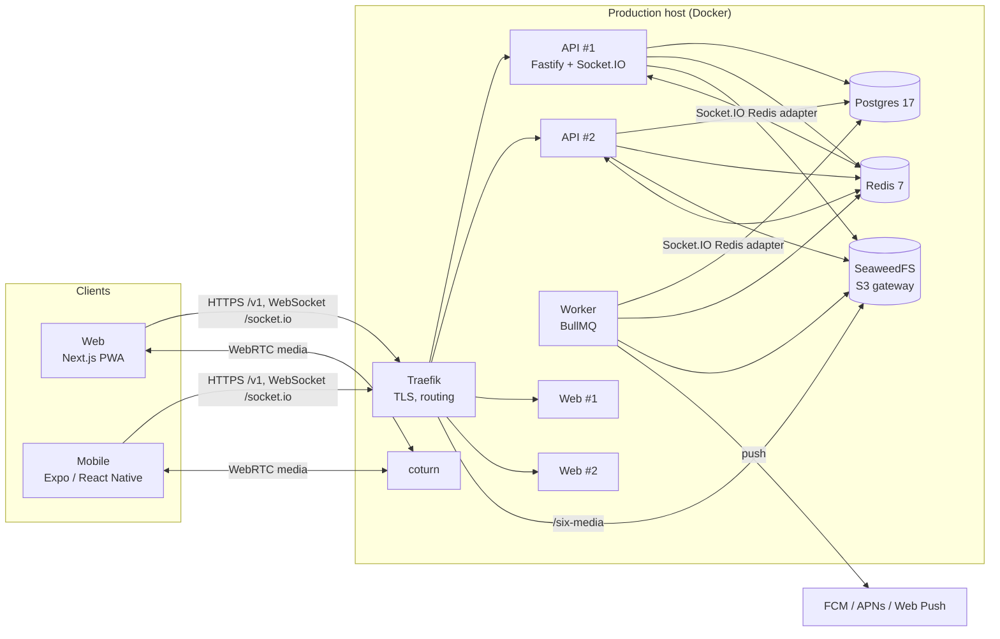

# Six Frites

Six Frites is a private, invite-only chat app for people who already know each other. It has end-to-end encrypted one-to-one and group chats, stories, anonymous messages, voice and video calls, and a lot of games. The interface is in English, French and Malagasy.

On Six Frites nobody shows up under their real name. Each person appears under a random colour code (like `#EF4535`) with a fast-food or vegetable picture, and every contact sees them under a different one.

- Web: [six-frites.koera.mg](https://six-frites.koera.mg), installable as a PWA
- Android: Google Play and [Koera Store](https://store.koera.mg)
- iOS: App Store build (see [docs/app-store.md](docs/app-store.md))

---

## Contents

1. [What members can do](#what-members-can-do)
2. [Architecture](#architecture)
3. [Repository layout](#repository-layout)
4. [Tech stack](#tech-stack)
5. [Backend (`apps/api`)](#backend-appsapi)
6. [End-to-end encryption and calls](#end-to-end-encryption-and-calls)
7. [Web app (`apps/web`)](#web-app-appsweb)
8. [Mobile app (`apps/mobile`)](#mobile-app-appsmobile)
9. [Shared packages](#shared-packages)
10. [Running it locally](#running-it-locally)
11. [Tests and CI](#tests-and-ci)
12. [Production and deploys](#production-and-deploys)
13. [Mobile releases](#mobile-releases)
14. [Release notes](#release-notes)
15. [Working with Claude Code](#working-with-claude-code)
16. [Further docs](#further-docs)

---

## What members can do

**Accounts**
- Sign in with Google, Apple or Facebook.
- Sign in on a computer by scanning a QR code with the phone. Past messages come along.
- See and log out devices, and delete the account.

**Invites and joining**
- You can only join with an invite link. A link can have a message, a number of uses (up to 10) and an expiry (up to 30 days), and it can be revoked.
- Each member gets an invite quota.
- Past the member cap, new people wait on a waiting list, or sign-ups close.
- Guest accounts can only send anonymous messages and use support.

**Contacts**
- Add people with a contact code, either single-use or reusable for up to 7 days.
- Give contacts private names, labels and photos that only you see.
- Sort contacts, poke one you haven't heard from (by email, a few times a day), and block people.

**Chats**
- Direct chats can be pinned, archived (behind the app lock) and muted.
- Chats show typing, presence, delivered and read ticks, themes and bubble colours.
- Groups have 3 to 50 people and are joined by link only.
  - Admins can make a group read-only, open comments on a message, or close the group for a while.
  - Groups have polls with up to 12 answers, and mentions with `@name`, `@admin` and `@everyone`.

**Messages**
- Reply, react, edit, delete, forward, pin, and select up to 25 messages at once.
- Formatting: bold, italic, spoiler, highlight and colour.
- Slash commands: `/silent`, `/schedule`, `/vanish`, `/autodelete`, `/blur`, `/search`, `/voice` and `/play`.
- Timed messages: scheduled messages, auto-delete timers, vanish mode, and view-once 🔥 messages.
- An offline queue sends messages when you're back online, and drafts sync between phone and web.
- Checklists, location sharing, in-chat search, and a media/files/links browser.

**Media**
- Photos, albums, trimmable videos, voice notes with voice effects, video notes, and files up to 1 GB.
- A photo editor (crop, draw, blur, text, emoji).
- GIFs and sticker packs, plus a data saver.

**Stories and notes**
- Stories last 1 hour to 1 day. The editor has GIFs, places, shapes, text styles, links and questions.
- Notes sit above your photo, and contacts can react to them.

**Anonymous messages**
- A personal link lets anyone write to you without saying who they are. Senders don't need an account.
- Links can be temporary, and an anonymous message can be shared back as a story card.

**Calls**
- One-to-one voice and video calls.
- Reactions and voice effects during the call.
- In-call games: rock-paper-scissors, dice, and guess the number.

**Games**
- Turn-based chat games: battleship, connect four, hangman, draw-and-guess and more.
- Live games for up to 4 players, with a bot filling empty seats: Fanorona (Madagascar's board game), Ludo, Crazy Eights, Word Hunt, Dots and Boxes, Memory, Reflex, Market Memory and Snack Race.

**Privacy**
- Signal-style end-to-end encryption, including media.
- Restore your history with a recovery key or a PIN-protected backup.
- Safety numbers shown as emoji or a QR code.
- An app lock.
- Screenshots are blocked in chats, and attempts are announced to the chat.

**Notifications**
- A notifications tab.
- Push notifications with selectable tones, and web push.

**Six Frites News**
- Every deploy is announced in a read-only chat, in each member's language.
- That chat also has about 55 searchable tips, and support is one tap away.

**Moderation (staff)**
- A queue for reports.
- Timed or permanent bans, either account-wide or chats-only.
- Per-user limits, usage stats, announcements, a mail log and sticker-pack import.
- Two-factor sign-in (TOTP) is required.

**Ads**
- AdSense banners on the web only. An admin can turn them off per user.

---

## Architecture



- **One API, two instances.** Fastify serves REST under `/v1` and Socket.IO on the same port. The two instances share sockets through the Socket.IO Redis adapter.
- **Every change is an event.** Each data change writes a `ChangeEvent` row inside its transaction. After the commit it is pushed as a socket `change` event. A client that reconnects catches up with `GET /v1/sync?since=<eventId>`.
- **Slow work runs in one worker.** Video transcoding, scheduled and expiring messages, push notifications and emails all go through BullMQ queues in Redis.
- **Media goes straight to storage.** Clients upload and download directly with presigned URLs. Encrypted media is encrypted before it leaves the device.
- **The server never reads message content.** It stores one encrypted envelope per recipient device.

---

## Repository layout

npm workspaces monorepo:

```
apps/
  api/        Fastify API, Socket.IO, BullMQ worker, Prisma schema and migrations
  web/        Next.js web app (App Router), PWA service worker, admin pages
  mobile/     Expo / React Native app for Android and iOS, release scripts
packages/
  shared/     Zod schemas and types, game rules, i18n dictionaries (en/fr/mg), changelog
  sdk/        Typed API client (generated from OpenAPI), realtime client, uploads, E2EE
  crypto/     X3DH + Double Ratchet, media encryption, backups, safety numbers
infra/        Traefik route config, Caddy gateway, SeaweedFS dev credentials
scripts/      deploy.sh (local/CI side) and server-deploy.sh (server side)
docs/         Deploy, E2EE design, server performance, store listings
RELEASE_NOTES.md   What members are told after each deploy
```

The packages have no build step. Their `exports` point straight at the `src/*.ts` files, and the apps compile them from source (`transpilePackages` in Next, Metro on mobile).

---

## Tech stack

| Area | Choice |
|---|---|
| Language | TypeScript everywhere |
| API | Node 24, Fastify 5, `fastify-type-provider-zod`, Zod 4, Swagger/OpenAPI |
| Realtime | Socket.IO with the Redis adapter and the Redis emitter |
| Database | PostgreSQL 17 through Prisma 7 (`@prisma/adapter-pg`) |
| Queues and cache | Redis 7 with BullMQ |
| Object storage | SeaweedFS S3 gateway, AWS SDK v3 |
| Media processing | ffmpeg (webp thumbnails, x264 transcode) |
| Web | Next.js 16 (App Router, webpack), React 19, Tailwind CSS 4, TanStack Query 5, Zustand 5 |
| Mobile | Expo SDK 58, React Native 0.88, expo-router, Reanimated 4, TanStack Query 5, Zustand 5 |
| Crypto | `@noble/curves`, `@noble/ciphers`, `@noble/hashes`, `@scure/bip39` |
| Calls | WebRTC (`react-native-webrtc` on mobile), coturn for TURN |
| Push | FCM HTTP v1, APNs over HTTP/2, Web Push (VAPID) |
| Auth | Google ID tokens; Firebase Auth for Apple and Facebook; JWT plus rotating refresh tokens |
| Tests | Vitest |
| Hosting | Docker Compose on a VPS, Traefik with Let's Encrypt, GitHub Actions |

---

## Backend (`apps/api`)

### Entry points

- **`src/server.ts`** starts the HTTP and Socket.IO server on `PORT` (4000 in dev). On startup it checks that the storage bucket exists, seeds the built-in stickers and ends stale live-game invites.
- **`src/app.ts`** builds the Fastify app. It registers CORS, cookies, a rate limit (300 requests a minute, keyed by token or IP), Swagger UI at `/docs` and `/health`. Every route module is mounted under `/v1`.
- **`src/worker.ts`** is the background worker. It runs as a separate process.
- **`src/env.ts`** validates the environment with Zod at boot.

Each folder has one job:

| Folder | Holds |
|---|---|
| `routes/` | Thin HTTP layers |
| `services/` | The business logic |
| `lib/` | Prisma, Redis, queues, storage, tokens, realtime, presence, TOTP |
| `plugins/` | Auth guards and error handling |
| `socket/` | Socket.IO handlers |
| `media/` | ffmpeg |
| `push/` | Push providers |
| `mail/` | Email |

### Routes (`src/routes/`)

| Module | What it covers |
|---|---|
| `auth.ts` | Google and Firebase sign-in, QR sign-in (`/auth/link`, `/auth/link/claim`), refresh, logout |
| `me.ts` | Profile, terms, contact codes and links, app lock, blocks, uploads, account deletion |
| `sessions.ts` | List and revoke sessions |
| `devices.ts` | E2EE device keys and prekeys, QR device-link approval, backup key, backup PIN, message backups |
| `chats.ts` | Chats and messages: threads, reactions, checklists, polls, games, views, envelopes, self-destruct, scheduled messages, `/sync`, the bot and support chats |
| `groups.ts` | Create and join groups by link, members, roles, leaving |
| `invites.ts` | Invite links, quotas, referrals |
| `calls.ts` | ICE servers (time-limited TURN credentials), call log |
| `uploads.ts` | Presigned single and multipart uploads |
| `push.ts` | Push config and token registration |
| `presence.ts` | Online presence |
| `stickers.ts` | Sticker packs, search, saved packs, GIFs (Giphy/Klipy) |
| `stories.ts` | Stories and notes, views, reactions, viewers |
| `links.ts` | Link previews, place search, map previews and the map picker (Google Maps, with monthly per-user quotas) |
| `ask.ts` | Anonymous "ask" links and messages |
| `notifications.ts` | The notifications tab |
| `mail.ts` | Poke emails and unsubscribe |
| `releases.ts` | Latest Android release from Koera Store, download, store webhook |
| `admin.ts` | Admin sign-in with TOTP, stats, users (bans, limits, ads), announcements, moderation, mail log, reports, sticker import |
| `emoji.ts` | Lottie data for animated emoji |

The OpenAPI spec is exported to `apps/api/openapi.json`. The Socket.IO events are described in `apps/api/asyncapi.yaml`.

### Authentication

- **Google:** ID tokens are verified against `GOOGLE_CLIENT_IDS` (`lib/google.ts`).
- **Apple and Facebook:** these go through Firebase Auth (`lib/firebase.ts`). The Firebase project is shared with other apps, so the API only accepts this app's providers.
- **Sessions:**
  - Access tokens are HS256 JWTs that last 15 minutes.
  - Refresh tokens look like `<sessionId>.<secret>`, last 30 days, are stored hashed and rotate on every use.
  - Replaying an old refresh token revokes the whole session.
  - Bans are checked on every refresh.
- **QR sign-in on a computer:**
  1. The computer starts a `DeviceLink`, which lives 2 minutes, and polls it.
  2. The phone approves the link.
  3. The phone seals the backup key to the computer's one-time key, so the server never sees it.
- **Sign-up gating:** `INVITE_ONLY` requires an invite code, `MAX_USERS` caps the number of accounts, and `User.inviteLimit` sets each person's invite quota.
- **Admins:** an admin is an address in `ADMIN_EMAILS` and must pass TOTP two-factor, asked again every 12 hours. `ADMIN_SKIP_2FA` turns this off outside production.

### Data model

- **Files:** the schema is `apps/api/prisma/schema.prisma`, with migrations in `apps/api/prisma/migrations/`. The Prisma client is generated into `src/generated/prisma`.
- **Main models by area:**

| Area | Models |
|---|---|
| Accounts | `User` (bans, guest flag, invite quota, ads flag, TOTP, locale, soft delete), `Session` (with the device id, so bans reach every account on a phone), `DeviceLink` |
| E2EE | `Device`, `OneTimePreKey`, `MessageEnvelope` (one ciphertext per device), `MessageBackup` |
| Chats | `Chat` (direct or group, support, auto-delete, vanish mode, theme), `ChatMember`, `ChatBan`, `Message`, `ScheduledMessage`, `MessageHidden`, `MessageView`, `MessageReaction`, `ChecklistMark`, `PollVote`, `GameMove` |
| Realtime and push | `ChangeEvent` (the log behind `/sync`), `PushToken` |
| Contacts | `ContactLink`, `ContactOverride`, `Block`, `Invite`, `Referral` |
| Media | `Upload`, `StickerPack`, `Sticker`, `SavedStickerPack` |
| Anonymous messages | `AnonMessage`, `AskLink`, `AnonBlock` |
| Social | `Story`, `StoryView`, `Note`, `NoteView`, `Notification`, `Poke` |
| Moderation | `Report`, `MailLog` |

- **Migrations must stay backward-compatible.** During a rolling deploy the old code briefly runs against the new schema.

### Realtime

- Clients connect to Socket.IO with their bearer token (`src/socket/`).
- **Client to server**, all acknowledged:
  - sending messages, typing, delivered and read receipts;
  - call signalling, which is relayed and never stored;
  - `live:*` events for multiplayer game rooms.
- **Server to client:** a `change` event for every committed data change. The worker emits events without holding sockets, through `@socket.io/redis-emitter`.
- **Presence and active sessions** are Redis keys with a TTL. The worker uses them to skip push notifications to a device that is already open.

### Worker (`src/worker.ts`)

| Queue | Concurrency | Jobs |
|---|---|---|
| `media` | 2 | ffmpeg thumbnails and transcodes, sticker-pack import, hourly purge of abandoned uploads |
| `timers` | 4 | A 10-second sweep (see below), an hourly mail sweep, delayed jobs that expire self-destructing messages and their files |
| `push` | 8 | Message and reaction pushes |

The 10-second sweep:
- sends due scheduled messages;
- deletes auto-delete messages that have expired;
- lifts expired bans;
- deletes expired stories;
- drops notifications older than 30 days.

Each time the worker starts, which is after every deploy, it posts the new sections of `RELEASE_NOTES.md` to Six Frites News (see [Release notes](#release-notes)).

### Storage, push and mail

- **Storage:** SeaweedFS's S3 gateway (`lib/storage.ts`).
  - Clients get presigned PUTs. Multipart parts stay under Cloudflare's 100 MB request limit.
  - Download links are presigned GETs valid for 7 days, signed as of the start of the UTC day so URLs stay stable and cacheable.
  - In production the bucket `six-media` is served through the proxy under `/six-media`.
- **Push** (`src/push/providers.ts`):
  - Web Push with VAPID;
  - FCM HTTP v1 for Android, with separate registrations for the Koera Store and Play builds;
  - APNs with a `.p8` token key for iOS.
  - Each token stores the device's locale and chosen tone.
- **Mail:** SMTP, used for pokes, announcements and occasional emails. Every email is logged in `MailLog` for 90 days.

---

## End-to-end encryption and calls

The full design is in [docs/e2ee-and-calls.md](docs/e2ee-and-calls.md).

**Protocol**
- Signal-style: X3DH starts a session, then the Double Ratchet runs on every message. This gives forward secrecy and post-compromise security.
- Primitives: Ed25519, X25519, HKDF-SHA-256 and XChaCha20-Poly1305, from the audited `@noble` libraries. There is no hand-rolled cryptography.

**Devices**
- Every signed-in session is a device with its own keys.
- A message is encrypted once for each of the recipient's devices and each of your own other devices. One more copy is sealed to your backup key.
- The API rejects a send made with an outdated device list (`DEVICES_CHANGED`), so no device is silently left out.

**Media**
- Media is encrypted on the client in 64 KB chunks.
- Each chunk's nonce is bound to its position and the last chunk is flagged, so chunks can't be reordered or truncated.
- Video streams by decrypting chunks on the fly. On the web, a service worker handles `/stream/*` requests for this.

**Backups**
- A 24-word recovery key (BIP39) derives the backup key.
- Alternatively, the backup key is wrapped under a 4–8 digit PIN mixed with a secret only the server holds. The server checks PIN attempts and limits them, so a PIN can't be guessed offline.

**Safety numbers**
- 60 digits, shown as 12 emoji or a QR code.
- Members are told when a contact's key changes.

**What the server can still see**
- Who talks to whom and when.
- Message types and sizes, reactions, receipts and timers.

**Calls**
- One-to-one WebRTC calls, encrypted by DTLS-SRTP.
- Signalling goes through the ratchet sessions over Socket.IO.
- coturn relays the media when a direct path fails. Its credentials are time-limited HMACs made from `TURN_SECRET`.

The design doc still lists an external security review of `packages/crypto` as an open step.

---

## Web app (`apps/web`)

**Framework**
- Next.js 16 with the App Router. It runs with `--webpack`.
- React 19, Tailwind CSS 4 and `lucide-react` icons.
- `proxy.ts` (Next 16's middleware) sends signed-out visitors from `/` to `/welcome`.

**Data**
- `lib/six.ts` creates the SDK client.
- TanStack Query caches server data. Zustand holds the client stores: session, presence, typing, outbox and calls.

**Realtime**
- `lib/realtime.tsx` keeps a Socket.IO connection (connecting, syncing, live or offline).
- It decrypts incoming changes and patches them into the query cache.

**Routes**
- Signed in, under `app/(app)/`:
  - `/` (the chat list), `/chats/[id]`, `/contacts`, `/inbox` (anonymous messages), `/notifications`, `/settings`, `/archived`, `/tips`, `/play/[id]`;
  - link pages: `/add/[code]`, `/g/[code]`.
- Public:
  - `/welcome`, `/login`, `/invite/[code]`, `/ask/[code]`;
  - `/about`, `/privacy`, `/terms`, `/support`, `/delete-account`.
- Auth: `/auth/google`, `/auth/facebook`, and `/auth/app`, the page the mobile app opens for Apple and Facebook sign-in.
- Admin: `/admin`, for admins only. Its tabs are overview, reports, anonymous messages, users, announcements, emails, large files and stickers.

**PWA and push**
- `app/manifest.ts` makes the site installable.
- `sw/sw.js` is bundled by esbuild into `public/sw.js`. It handles push notifications, notification clicks and encrypted video streaming.
- `public/.well-known/` holds the Android and iOS app-link files.

**E2EE in the browser**
- Keys live in IndexedDB, sealed with AES-GCM under a non-extractable WebCrypto key.

**Calls**
- `lib/call.ts` (WebRTC). Group live game rooms are in `lib/live.ts`.

**i18n**
- `lib/i18n.tsx` uses the dictionaries from `@six/shared`.
- The language comes from the `six-locale` cookie, then from `Accept-Language`.

**Ads**
- `components/ad-banner.tsx` shows AdSense when `NEXT_PUBLIC_ADSENSE_*` is set and the member has ads on.

---

## Mobile app (`apps/mobile`)

**Framework**
- Expo SDK 58 and React Native 0.88, with typed routes (expo-router).
- It uses a dev client (`expo-dev-client`), not Expo Go.
- Styling is plain `StyleSheet`, with `lib/theme.ts`.

**Screens** (`src/app/`)
- `_layout.tsx` sets up the providers: gestures, safe area, keyboard, React Query, share intent, theme, terms and locale.
- Tabs, in `(app)/(tabs)/`: chats, contacts, notifications, inbox and settings.
- Other screens: `chats/[id]`, `play/[id]`, `archived`, `tips`, `login`, `guest`, `invite/[code]`, `add/[code]` and `g/[code]`.
- `+native-intent.tsx` handles `sixfrites://` links and shared content.

**Sign-in**
- Google One Tap through `react-native-nitro-google-signin`.
- Apple on iPhone through `expo-apple-authentication`, swapped for a Firebase token.
- Facebook, and Apple on Android, open the website's `/auth/app` page. The token comes back sealed to a one-time key (`lib/social-sign-in.ts`).

**Native features**

| Feature | Module |
|---|---|
| Push notifications | `expo-notifications`, with eight custom tones |
| Refresh token, device id, E2EE keys | `expo-secure-store` |
| Screenshot blocking and notices | `expo-screen-capture` (`lib/no-screenshots.ts`) |
| Calls | `react-native-webrtc` and `react-native-incall-manager` |
| App lock | `expo-local-authentication` |
| Maps | `react-native-maps` |
| Camera, gallery and video | `expo-camera`, `expo-image-picker`, `expo-video`, `expo-audio` |
| Receiving shares from other apps | `expo-share-intent`, plus an iOS extension |

- `modules/rich-input` is a local Expo module that lets Android keyboards paste images.

**Config** (`app.config.ts`)
- Bundle id `com.sixfrites.app` on both platforms.
- App links on `six-frites.koera.mg` open in the app.
- Build variants come from environment variables. `PLAY_STORE=1` makes the Play build, which has no gallery permissions and no in-app update banner. Other variables supply the Firebase files and the Maps key.

---

## Shared packages

### `@six/shared`
The contract between the API and the clients.
- **Zod schemas and DTOs** for every feature. Their `.describe()` text ends up in the OpenAPI docs.
- **Limits and constants:** message types, poll limits, 3–50 members per group, 1 GB uploads, encryption up to 100 MB.
- **Game rules** for every live game, as pure functions, so the server and both clients agree on the rules.
- **i18n:** `src/i18n/` has 21 namespaces. Each defines `en`, and `fr` and `mg` are typed `typeof en`, so a missing translation is a type error.
- **Release notes:** `changelog.ts` holds the Android release notes, and `parseReleaseNotes()` reads `RELEASE_NOTES.md`.

### `@six/sdk`
The client used by web and mobile.
- **REST client:** `src/schema.d.ts` is generated from `openapi.json` by `npm run sdk:generate`. Calls go through `openapi-fetch`, with middleware that adds the bearer token and refreshes once on a 401.
- **`TokenManager`** keeps the access token in memory and shares a single refresh request, so a refresh token is never rotated twice.
- **Realtime:** a Socket.IO client with a sync cursor.
- **Uploads:** multipart, four parts at a time, three tries per part.
- **E2EE:** the `E2EE` class handles devices, sessions, sealing and opening, backups, and file encryption. Each app plugs in its own key store.

### `@six/crypto`
- X3DH, the Double Ratchet, keys, chunked media encryption, the recovery key and PIN backup, safety numbers, and the sealed box used for QR linking.
- The same code runs on Node, in the browser and on Hermes.

---

## Running it locally

**Requirements:** Docker, and Node 24 for the tools outside Docker.

```sh
cp .env.example apps/api/.env
cp apps/web/.env.example apps/web/.env.local
docker compose up
```

`docker compose up` starts the whole dev stack. Each service reloads when you change its code.

| Service | Port | What it runs |
|---|---|---|
| `postgres` | 5432 | PostgreSQL 17 |
| `redis` | 6379 | Redis 7 |
| `storage` | 8333 | SeaweedFS S3 gateway |
| `api` | 4000 | `prisma migrate deploy`, then `tsx watch src/server.ts` |
| `worker` | – | `tsx watch src/worker.ts` |
| `web` | 3000 | `next dev` |

An `install` service runs `npm ci` only when `package-lock.json` changes. After you add a migration, apply it with `npx prisma migrate deploy` in `apps/api`.

Open http://localhost:3000. The API docs are at http://localhost:4000/docs.

**Mobile**

```sh
apps/mobile/scripts/dev.sh a      # Android emulator and USB phones
apps/mobile/scripts/dev.sh i      # iPhone simulator
apps/mobile/scripts/dev.sh all    # both
apps/mobile/scripts/dev.sh a prod # point the app at production
```

- The script starts Metro and reverses the API, web and storage ports to Android devices with `adb reverse`. Then it opens the dev client.
- First install: `npx expo run:android` or `npx expo run:ios`.

**Useful commands**

| Command | Does |
|---|---|
| `npm run typecheck` | Type-check every workspace |
| `npm test` | Run every workspace's tests |
| `npm run sdk:generate` | Export OpenAPI from the API and regenerate the SDK types |
| `npm run db:migrate` | Create a Prisma migration (`prisma migrate dev`) |
| `npm run deploy` | Deploy from your machine (fallback for CI) |

There is no formatter. Code is formatted by hand with wide lines, so don't run Prettier over it.

---

## Tests and CI

**API** (`apps/api/test/`)
- About 50 Vitest files, run one file at a time.
- They use the real dev Postgres, in the `test` schema, plus real Redis and SeaweedFS. `test/global-setup.ts` runs the migrations, then empties every table.
- Google and Firebase token checks are mocked.

**Packages**
- `@six/shared` covers game rules, release-note parsing, mentions, markup and more.
- `@six/crypto` covers round trips, out-of-order messages, replays, tampering and forward secrecy.
- `@six/sdk` covers uploads.

**CI**
- `.github/workflows/deploy.yml` runs on every push to `main`.
- The **test** job starts Postgres, Redis and storage, then runs `npm run typecheck` and `npm test`.
- The **deploy** job runs only if the tests pass. Test files are typechecked too, so a type error in a test blocks the deploy.

---

## Production and deploys

**Host**
- A Contabo VPS in France, shared with other projects. The domain is `six-frites.koera.mg`.

**Stack** (`docker-compose.prod.yml`)
- One image, `six-frites:latest`, built from `Dockerfile`, runs every app service.
- Two API containers, two web containers and one worker.
- Postgres, Redis (AOF on) and SeaweedFS.
- coturn on the host network, on port 3478 with UDP relay ports 49160–49200.

**Proxy**
- The server's Traefik, configured by `infra/traefik/six-frites.yml`, handles Let's Encrypt TLS, HTTP→HTTPS and HSTS.
- It routes `/v1`, `/socket.io`, `/docs` and `/health` to the API pair, `/six-media` to storage, and everything else to the web pair.
- Visitors stay on one web container through the sticky cookie `six_web`.
- `docker-compose.public.yml` is an alternative to Traefik: a Caddy gateway for exposing the stack through a tunnel.

**Deploy**
1. Pushing to `main` runs CI. When the tests pass, CI runs `scripts/deploy.sh`.
2. `deploy.sh` copies the committed tree to the server with `git archive` over SSH and deletes files that left the repo.
3. It then runs `scripts/server-deploy.sh` under a lock. That script updates the Traefik config, builds the image and runs the migrations.
4. It replaces the containers one at a time (`api-2`, `api`, `web-2`, `web`) and waits for each to be healthy, so there is no downtime.
5. The restarted worker posts the release notes.

`npm run deploy` does the same from a developer machine. Details are in [docs/deploy.md](docs/deploy.md).

**Performance**
- Most of the slowness members feel comes from about 470 ms of network round trip between Madagascar (Starlink) and France, not from the server.
- [docs/server-performance.md](docs/server-performance.md) lists the planned fixes.

**Backups**
- Backups are manual `pg_dump`s. Data lives in the `pgdata` and `seaweeddata` volumes.

---

## Mobile releases

**Before you build**
- The version in `apps/mobile/app.config.ts` must have an entry in `packages/shared/src/changelog.ts`, or the build stops.

**Android, Koera Store APK**
- `scripts/build-android-release.sh` builds the APK and signs it with the app's own key. A v3 signing lineage lets phones with the old build update in place.
- `scripts/publish-android-release.sh` uploads it to Koera Store. The store's webhook makes the API tell phones that an update is out.

**Android, Google Play AAB**
- `scripts/build-android-play.sh` builds the Play bundle with `PLAY_STORE=1`.
- Store listing material is in [docs/play-store.md](docs/play-store.md) and `apps/mobile/store-listing/`.

**iOS**
- `scripts/build-ios-release.sh` archives with distribution signing, exports, and uploads to App Store Connect / TestFlight.
- `scripts/ios-signing-setup.mjs` sets up the certificate and profiles.
- The listing material and review notes are in [docs/app-store.md](docs/app-store.md).

**After a build**
- `scripts/record-release.mjs` records each successful build in `apps/mobile/RELEASES.md`: version, build number, commit, sha256 and notes.

---

## Release notes

Members learn about changes from **`RELEASE_NOTES.md`**. After each deploy, the worker posts every section members haven't had yet to their Six Frites News chat, as one message in their language.

How to write a section (the full rules are in `CLAUDE.md`):

- Every commit that changes what members see or can do adds a section at the top in that same commit.
  - Head it `## <date "+%Y-%m-%d %Hh%M">`.
  - Under it, put `### en`, `### fr` and `### mg`, with the same `- ` lines in each language.
- Write for members: what they can do now, in plain words. Leave out file and component names, and skip refactors, tests, CI, docs and admin pages.
- Sections already on `origin/main` have been sent. Never edit them.
- `npm test -w @six/shared` checks the file's format.

---

## Working with Claude Code

The repo carries project tooling for Claude Code in `.claude/`.

**Agents** (`.claude/agents/`)

| Agent | Role |
|---|---|
| `conversations` | Owns everything inside chats and groups, across the API, shared code, web and mobile |
| `release-builder` | Builds the production Android and iOS apps and keeps `RELEASES.md` up to date |
| `test-runner` | Runs the typecheck and the full test suite as CI does, and fixes failing tests |

**Commands** (`.claude/commands/`)

| Command | Does |
|---|---|
| `/app` | Run the dev build on Android, iOS or both |
| `/build` | Build the production mobile apps |
| `/screenshot` | Screenshot a connected phone or the simulator into `~/Downloads` |
| `/commit-all` | Commit every uncommitted change, one commit per piece of work |
| `/commit-session` | Commit only the work of one Claude session |

**Hook:** `.claude/settings.json` reminds Claude to run `test-runner` whenever a test file is edited.

---

## Further docs

| Doc | About |
|---|---|
| [docs/deploy.md](docs/deploy.md) | Server setup, CI deploys, rolling restarts, migrations |
| [docs/e2ee-and-calls.md](docs/e2ee-and-calls.md) | Encryption protocol, devices, backups, calls |
| [docs/server-performance.md](docs/server-performance.md) | Where the latency comes from and what to do about it |
| [docs/play-store.md](docs/play-store.md) | Google Play listing kit |
| [docs/app-store.md](docs/app-store.md) | App Store listing kit and review notes |
| `apps/api/openapi.json` | REST API spec (also browsable at `/docs`) |
| `apps/api/asyncapi.yaml` | Socket.IO events |
